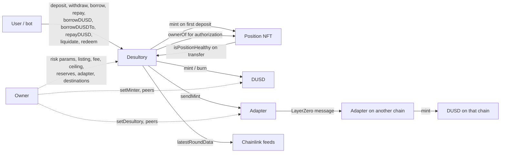
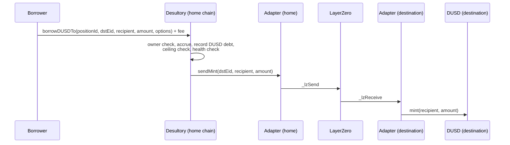

# Architecture

The one-page picture: which contracts exist, who may call whom, and how the main flows
move through them. The other notes in this zone go deeper on each piece. Unfamiliar terms
are in [[Glossary]].

## The contracts

| Contract | Role | Size |
|---|---|---|
| `Desultory` | The pool. Holds every deposited token, and all collateral and debt accounting, keyed by position id. Almost all logic lives here. | ~1,700 lines |
| `Position` (`PositionNFT.sol`) | ERC721. Token id = position id. Owning the token is owning the position. | ~60 |
| `DUSD` | The stablecoin. A LayerZero OFT whose `mint`/`burn` are restricted to an allowlist of minters. | ~50 |
| `Adapter` | LayerZero OApp. Carries "mint X DUSD to Y" messages between chains. The same contract runs on every chain. | ~75 |
| `VoteToken` | Bare OFT. A placeholder; nothing uses it. | 13 |

Storage-free libraries, linked into `Desultory`: `LiquidationMath` (health factor, close
factor, seize/repay conversion, bonus split), `RedemptionMath` (the redemption fee pair),
`OracleLib` (Chainlink wrapper with a 3-hour staleness check).

## Who may call what

- **Authorization is NFT ownership.** `withdraw`, `borrow`, `borrowDUSD` and `borrowDUSDTo`
  require `positionNFT.ownerOf(positionId) == msg.sender`. `deposit`, `repay`, `repayDUSD`,
  `liquidate` and `redeem` are open to anyone. `deposit(0, ...)` mints a new position.
- **`Desultory` owns `Position`.** Only `Desultory` can mint positions. In return
  `Position` calls back into `Desultory` on every transfer and refuses to move a
  liquidatable position (see [[Positions]]).
- **Two DUSD minters:** `Desultory` for local borrows and burns, and `Adapter` for mints
  that another chain authorized.
- **One `Ownable` owner** controls every admin setter on all three contracts. In the
  deploy script this is the deployer's address. [[Threat-Model]] lists what that key can do.

## Flows

### Deposit and borrow a pool asset

1. `deposit(positionId, token, amount)` accrues the token's pool, pulls the tokens, and
   credits scaled deposits to the position. Position id `0` mints a new NFT first.
2. `borrow(positionId, token, amount)` checks the caller owns the NFT, accrues, records
   scaled debt, and checks that the position stays within its LTV limit and that the pool
   has the cash (`getAvailableLiquidity`).
3. Interest accrues lazily. Every state-changing call starts with `accrue(token)`: the borrow
   index rises by the kinked rate (see [[Interest-Rate-Model]]), 10% of the interest goes to
   `pool.reserves` and the rest raises the liquidity index that depositors earn from. See
   [[Accounting]].

### Borrow DUSD on another chain

The debt is recorded on the home chain **before** the message leaves, and every check runs
there. The receive side only mints and must never revert. To repay, the borrower bridges
DUSD home with the OFT's own `send()` and calls `repayDUSD`. See [[Cross-Chain]] and [[DUSD]].

### Liquidate

When a position's health factor drops below 1, anyone may call `liquidate(positionId,
debtAsset, collateralAsset, repayAmount)`. They repay up to the close factor (50%, or 100%
below health factor 0.95) and receive collateral worth the repayment plus a per-token
bonus. Part of the bonus goes to reserves. `liquidateWithBackstop` is the same call, but the
protocol may convert its reserves into a deposit so the seizure can go ahead against a pool
that is short of cash. If a position ends with no collateral and leftover debt, that debt
is added to `totalBadDebtUSD`. It is counted, never spread across depositors. See
[[Liquidations]].

### Redeem DUSD

Anyone holding DUSD can burn it via `redeem` against a **healthy** position that owes DUSD,
receiving that position's collateral worth the same USD minus 0.5%. The position's DUSD debt
falls by the full amount burned. This is what holds DUSD at or above $0.995. Liquidation
needs health factor < 1 and redemption needs ≥ 1, so the two never apply to the same
position. See [[DUSD]].

## What is not here

- **No upgradeability.** Everything is deployed directly, with no proxies.
- **No pause.** There is no circuit breaker anywhere. Retiring a token (ADR 0009) stops new
  deposits and borrows in it, and that is the only brake.
- **No governance.** The owner is a single key.
- **Nothing is deployed.** `script/Config.s.sol` has an Anvil branch (mocks, local LayerZero
  endpoint) and a Sepolia branch with real addresses, but no deployment is recorded in the repo,
  and the deploy script sets no LayerZero peers.

## Related

- [[Glossary]] — the terms used above
- [[Threat-Model]] — trust assumptions and owner powers
- [[0001-nft-as-position]], [[0003-dusd-only-cross-chain-borrowing]], [[0004-liquidation-engine]]
